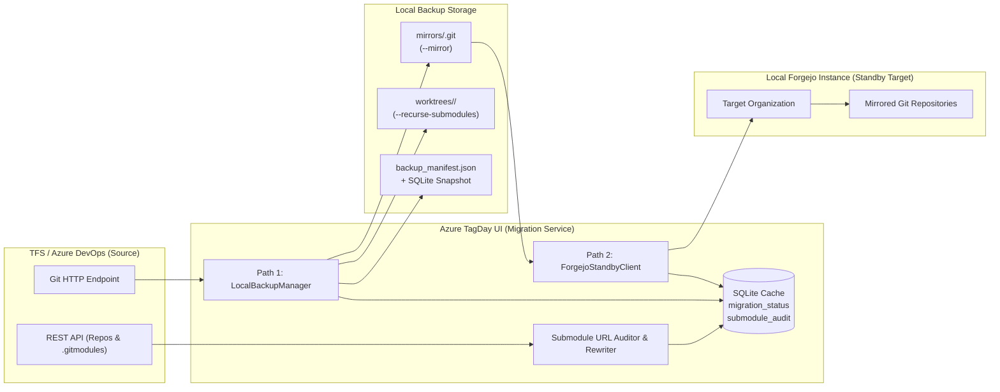

# TFS / Azure DevOps Backup & Git Migration Architecture (`MIGRATION.md`)

This document specifies the architecture, workflows, data model, CLI interface, and GUI design for the **Repository Backup & Standby Migration** feature in **Azure TagDay & DevOps Management UI**.

---

## 1. Objectives & Design Decisions

Due to stability and reliability concerns with the on-premise TFS / Azure DevOps instance, the tool provides a built-in, repeatable disaster-recovery and migration subsystem with the following core parameters:

1. **Operating Mode — Continuous Live Standby**:
   - Designed to run **repeatedly and incrementally** while TFS is still alive.
   - Tracks TFS `last_push_id` and branch/tag commit SHAs in the local SQLite database ([`src/azure/azure_db.py`](src/azure/azure_db.py)) to perform fast delta backups and standby pushes without re-cloning unchanged repositories.
2. **Path 1 — Local Repository Backup (Toggleable Format)**:
   - Users can choose via GUI toggle or CLI flag between:
     - **Working Tree (`worktree`)**: `git clone --recurse-submodules` (immediately usable local working directories with all submodules initialized and checked out).
     - **Bare Mirror (`mirror`)**: `git clone --mirror` (100% ref fidelity including all branches, tags, and notes; ideal as the source for Forgejo pushes).
     - **Both (`both`)**: Maintains both a `mirrors/` directory for exact ref replication and a `worktrees/` directory for immediate local development/builds.
3. **Submodule URL Audit & Relative-Path Conversion**:
   - Repository `.gitmodules` currently contain a mixture of relative paths (`../Repo`) and hardcoded absolute TFS URLs (`http://tfs:8080/tfs/...`).
   - Includes a dedicated **Submodule Check & Rewrite Function** that inspects `.gitmodules` across all repositories, flags absolute or broken URLs, previews the proposed relative path (`../<RepoName>.git`), and asks the user for confirmation before applying changes.
4. **Path 2 — Standby Migration to Local Git Instance (Forgejo)**:
   - **Phase 1 Scope**: Focused strictly on **Git repositories and submodules** (branches, tags, default branch configuration, and archived status).
   - Supports both **Push-Mirror Standby** (tool pushes updates from local mirror to Forgejo) and **Forgejo Pull-Mirror Configuration** (Forgejo periodically pulls from TFS).

---

## 2. System Architecture Overview



---

## 3. Submodule URL Audit & Relative-Path Check Function

### 3.1 Problem Statement
When repositories are cloned to a local folder or migrated to Forgejo, any `.gitmodules` file containing hardcoded TFS URLs (e.g., `http://tfs-server:8080/tfs/DefaultCollection/Project/_git/SubRepo` or `ssh://...`) will:
- Still attempt to contact the TFS server during `git submodule update`.
- Fail if TFS is offline or when developers clone from Forgejo.
- Break authentication if credentials differ between TFS and Forgejo.

Using relative URLs (`../SubRepo` or `../SubRepo.git`) ensures that Git resolves submodules relative to whichever remote the parent repository was cloned from (TFS, Forgejo, or local directory layout).

### 3.2 Discovery & Classification Pipeline
1. **Enable Submodule Syncing**:
   - Wire [`AzureInfoHandler.ParseSubmodules()`](src/azure/azure_info_handler.py) into `GetTFSRepositories()` (or run on-demand via `audit_submodules()`) to fetch `.gitmodules` from each repository's default branch (and optionally `dev`/`main`/`master`).
2. **URL Classification Rules**:
   Each entry `[submodule "<name>"]` in `.gitmodules` is parsed and classified into one of four states:

| Classification | Pattern Example | Action Required |
| :--- | :--- | :--- |
| `RELATIVE_OK` | `../CommonLib` or `../CommonLib.git` | **None** — Already portable across TFS, local folders, and Forgejo. |
| `ABSOLUTE_SAME_PROJECT` | `https://tfs/Collection/Project/_git/CommonLib` | **Recommend Convert** ➔ `../CommonLib` (matches known repository in the same project). |
| `ABSOLUTE_CROSS_PROJECT` | `https://tfs/Collection/OtherProj/_git/Shared` | **Warn & Ask** ➔ Either `../../OtherProj/Shared` (if multi-org) or `../Shared` (if flattened into one Forgejo org). |
| `EXTERNAL_OR_MISSING` | `https://github.com/org/lib.git` or deleted TFS repo | **Flag for Review** ➔ Target repo does not exist in active TFS project list or is third-party. |

### 3.3 Interactive Check & User Confirmation Workflow
When the user runs **Check Submodules** (via GUI button or `--check-submodules` CLI):
1. **Audit Report Generation**:
   - Displays a summary table of all repositories containing `.gitmodules`, total submodule count, how many are `RELATIVE_OK`, and how many require conversion.
2. **Diff Preview & User Prompt**:
   - For every repository with non-relative URLs, the tool generates the exact `.gitmodules` replacement diff:
     ```ini
     [submodule "libs/common"]
         path = libs/common
     -   url = http://tfs-server:8080/tfs/Collection/Project/_git/CommonLib
     +   url = ../CommonLib
     ```
3. **User Action Options**:
   - **Option A — Commit Directly to TFS (`Push .gitmodules Fix to TFS`)**:
     Uses the TFS Git Pushes REST API (`POST {project}/_apis/git/repositories/{repoId}/pushes?api-version=6.0`) to commit the updated `.gitmodules` on the target branch (e.g., `dev`) or create a Pull Request in TFS so both TFS and all future backups/migrations are permanently clean.
   - **Option B — Ephemeral URL Rewrite During Clone (`git config url.insteadOf`)**:
     If the user does not want to modify commits in TFS yet, Path 1 backup automatically injects `-c url."<local_or_tfs_base>".insteadOf="<tfs_project_base>"` so recursive submodule clones still succeed seamlessly.

---

## 4. Path 1: Local Repository Backup Engine

### 4.1 Directory Structure on Disk
To keep working trees, bare mirrors, and metadata cleanly separated when the toggle is set to `Both`:

```text
<backup_target_dir>/
├── backup_manifest.json           # Timestamp, project info, repo SHA matrix, verification summary
├── cache_snapshot/
│   └── <project_id>.db            # Consistent SQLite backup of work items, PRs, tags, and builds
├── mirrors/                       # Created when mode is "mirror" or "both"
│   ├── RepoA.git/                 # Bare mirror (all refs/heads/*, refs/tags/*, refs/pull/*)
│   └── CommonLib.git/
└── worktrees/                     # Created when mode is "worktree" or "both"
    ├── RepoA/                     # Checked-out default/dev branch + initialized submodules
    │   └── libs/common/           # Populated recursively
    └── CommonLib/
```

### 4.2 Cloning & Incremental Standby Sync Mechanics

| Mode | Initial Backup Command | Subsequent Standby Update (Incremental) |
| :--- | :--- | :--- |
| **Bare Mirror (`mirror`)** | `git clone --mirror <repo_url> mirrors/<name>.git` | `git -C mirrors/<name>.git remote update --prune` |
| **Working Tree (`worktree`)** | `git clone --recurse-submodules <repo_url> worktrees/<name>` | `git -C worktrees/<name> fetch --all --tags --prune` + `git -C worktrees/<name> pull --ff-only` + `git -C worktrees/<name> submodule update --init --recursive` |
| **Both (`both`)** | Clones `mirrors/<name>.git` first, then clones `worktrees/<name>` referencing local mirror objects (`--reference-if-able`) to save bandwidth and time. | Updates `mirrors/<name>.git` first, then fast-forwards `worktrees/<name>` and its submodules. |

### 4.3 Security & Authentication Handling
- **Zero Plaintext PATs on Disk**:
  The Personal Access Token (PAT) is **never** embedded in the clone URL (`https://:PAT@tfs/...`), preventing credentials from being persisted inside `.git/config` or `.git/modules/*/config`.
- **Ephemeral Header Injection**:
  All `git` subprocess invocations pass the HTTP Basic Authorization header transiently via command-line configuration:
  ```bash
  git -c http.extraHeader="Authorization: Basic <base64(:PAT)>" \
      -c http.sslVerify=false \
      clone --recurse-submodules ...
  ```
- **Ordering Dependency (Submodules First)**:
  Using the submodule dependency graph from `ParseSubmodules()`, leaf repositories (repositories that are used as submodules by others) are backed up **first**, followed by parent repositories.

### 4.4 Post-Backup Integrity Verification
After each repository backup finishes:
1. Verify `HEAD` commit SHA matches the latest branch SHA reported by TFS REST API.
2. In `worktree` mode, run `git submodule status --recursive` and check for any uninitialized (`-`) or conflicted (`U`) submodule states.
3. Record verification status (`VERIFIED`, `SUBMODULE_WARNING`, `FAILED`) in `backup_manifest.json` and SQLite.

---

## 5. Path 2: Standby Migration to Local Forgejo Instance

### 5.1 Forgejo REST API Client (`ForgejoClient`)
Implemented in `src/azure/migration_service.py` using standard library `urllib.request` (matching [`AzureBaseClient`](src/azure/azure_base_client.py) with zero extra dependencies):

- **Authentication**: `Authorization: token <forgejo_pat>`
- **Core Endpoints Used**:
  - `GET /api/v1/version` & `GET /api/v1/user`: Connectivity and token permission check.
  - `GET /api/v1/orgs/{org}` / `POST /api/v1/orgs`: Ensure target Organization exists.
  - `GET /api/v1/repos/{org}/{repo}`: Check if repository already exists on Forgejo.
  - `POST /api/v1/orgs/{org}/repos`: Create empty target repository (for Push-Mirror mode).
  - `PATCH /api/v1/repos/{org}/{repo}`: Sync `default_branch` (e.g., `dev`), `description`, and `archived` state (mapped from TFS `is_disabled`).
  - `POST /api/v1/repos/migrate`: Configure Forgejo-native Pull Mirror (if Pull-Mirror mode is selected).

### 5.2 Two Standby Synchronization Strategies

Users can choose how Forgejo stays in sync with TFS while TFS is alive:

#### Strategy 1: Tool-Driven Push Standby *(Recommended)*
1. The tool updates the local bare mirror (`mirrors/<Repo>.git`) from TFS (or directly uses a temporary bare clone).
2. Ensures the repository exists under the target Forgejo Organization.
3. Pushes all branches and tags to Forgejo:
   ```bash
   git -C mirrors/<Repo>.git push --prune <forgejo_repo_url> "+refs/heads/*:refs/heads/*" "+refs/tags/*:refs/tags/*"
   ```
   *(Note: Pushing explicit `refs/heads/*` and `refs/tags/*` instead of raw `--mirror` avoids pushing internal TFS `refs/pull/*` refs that Forgejo rejects as hidden/read-only refs).*
4. **Advantages**:
   - Works even if the Forgejo server/container is isolated and cannot authenticate to TFS directly.
   - Guarantees local disk backup (Path 1) and Forgejo (Path 2) are updated in a single coordinated pass.
   - Allows submodule `.gitmodules` inspection before pushing.

#### Strategy 2: Forgejo Native Pull-Mirror
1. Registers each TFS repository in Forgejo via `POST /api/v1/repos/migrate` with `"mirror": true`, `"service": "git"`, `"clone_addr": "<tfs_repo_url>"`, and `"auth_token": "<tfs_pat>"`.
2. Forgejo automatically polls TFS at its configured `mirror_interval` (e.g., every 1–8 hours) or when triggered via `POST /api/v1/repos/{org}/{repo}/mirror-sync`.
3. **Cutover Action**: When retiring TFS, a 1-click **"Convert Mirrors to Normal Repos"** action calls `PATCH /api/v1/repos/{org}/{repo}` (`{"mirror": false}`) to unlock normal pushes in Forgejo.

### 5.3 Handling Submodules in Forgejo
- **Topological Sync Order**: Submodule target repositories are created and pushed to the Forgejo Organization **before** parent repositories.
- **Organization Layout**: By placing all project repositories under the same Forgejo Organization (e.g., `http://forgejo.local/MyProject/<RepoName>.git`), any repository whose `.gitmodules` uses relative paths (`../<SubRepo>` or `../<SubRepo>.git`) works immediately on Forgejo without modifying commit hashes.

---

## 6. Database Schema & Configuration Additions

### 6.1 SQLite Tables ([`src/azure/azure_db.py`](src/azure/azure_db.py))

```sql
-- Tracks per-repository backup and Forgejo standby sync state
CREATE TABLE IF NOT EXISTS migration_status (
    repo_id TEXT PRIMARY KEY,
    repo_name TEXT NOT NULL,
    project_id TEXT NOT NULL,
    backup_mode TEXT,                   -- 'worktree', 'mirror', 'both'
    local_mirror_path TEXT,
    local_worktree_path TEXT,
    last_tfs_push_id INTEGER,           -- TFS push ID at last successful sync
    last_backup_at TEXT,                -- ISO-8601 timestamp
    local_status TEXT DEFAULT 'PENDING',-- 'OK', 'OUT_OF_SYNC', 'SUBMODULE_WARN', 'FAILED', 'PENDING'
    submodules_total INTEGER DEFAULT 0,
    submodules_non_relative INTEGER DEFAULT 0,
    forgejo_repo_url TEXT,
    last_forgejo_sync_at TEXT,
    forgejo_status TEXT DEFAULT 'PENDING', -- 'OK', 'OUT_OF_SYNC', 'FAILED', 'PENDING'
    last_error TEXT
);

-- Stores detailed .gitmodules audit results per repository
CREATE TABLE IF NOT EXISTS submodule_audit (
    parent_repo_id TEXT NOT NULL,
    parent_repo_name TEXT NOT NULL,
    submodule_name TEXT NOT NULL,
    submodule_path TEXT NOT NULL,
    current_url TEXT NOT NULL,
    classification TEXT NOT NULL,       -- 'RELATIVE_OK', 'ABSOLUTE_SAME_PROJECT', 'ABSOLUTE_CROSS_PROJECT', 'EXTERNAL_OR_MISSING'
    proposed_relative_url TEXT,
    target_repo_exists INTEGER DEFAULT 0,
    audited_at TEXT,
    PRIMARY KEY (parent_repo_id, submodule_path)
);
```

### 6.2 User Settings (`config/user_settings.yaml` & [`SettingsService`](src/gui/services/settings_service.py))

```yaml
migration:
  backup_target_dir: ""                 # Local root directory for Path 1 backups
  backup_mode: "both"                   # "worktree" | "mirror" | "both"
  verify_submodules: true
  auto_standby_sync: false              # Run incremental backup/Forgejo sync after scheduled TFS sync
  forgejo_url: ""                       # e.g. "http://localhost:3000"
  forgejo_token: ""                     # Forgejo API Personal Access Token
  forgejo_org: ""                       # Target Forgejo Organization name (defaults to TFS Project name)
  forgejo_strategy: "push"              # "push" (Tool pushes refs) | "pull_mirror" (Forgejo pulls from TFS)
```

---

## 7. CLI & GUI Integration

### 7.1 CLI Commands ([`src/devops_helper.py`](src/devops_helper.py))

```powershell
# 1. Audit all repositories for .gitmodules URLs and identify non-relative submodule paths
uv run python src/devops_helper.py --check-submodules [--submodule-branch dev]

# 2. Interactively convert hardcoded TFS submodule URLs to relative paths (prompts per repo)
uv run python src/devops_helper.py --fix-submodules [--submodule-branch dev] [--dry-run] [--yes]

# 3. Path 1: Clone / incrementally update all repositories locally
uv run python src/devops_helper.py --backup-repos --target-dir D:\TFS_Backup --backup-mode both [--force]

# 4. Path 2: Sync repositories to local Forgejo standby instance
uv run python src/devops_helper.py --sync-forgejo --forgejo-url http://forgejo.local:3000 --forgejo-org MyProject
```

### 7.2 Unattended Cronjob / Systemd File-Mirror CLI ([`src/file_mirror_cli.py`](src/file_mirror_cli.py))

For unattended scheduled execution (e.g. Linux `cron` or `systemd` timer), the dedicated [`src/file_mirror_cli.py`](src/file_mirror_cli.py) (`azure-tagday-mirror`) provides:
- **Zero-Secret Crontab Support**: Automatically reads `AZURE_BASE_URL`, `AZURE_COLLECTION`, `AZURE_PROJECT_ID`, and `AZURE_PERSONAL_ACCESS_TOKEN` from an existing project SQLite database (`--db-path reports/tfs_cache_CH_ELSA.db`), `user_settings.yaml`, or `.env`.
- **PID Lockfile Protection (`<target_dir>/.mirror.lock`)**: Prevents overlapping runs if a mirror job takes longer than the cron interval, and cleans up stale lockfiles automatically.
- **Timestamped Log File (`<target_dir>/mirror_cron.log`)** & **Exit Codes** (`0` = OK, `1` = one or more repositories failed).

```bash
# Mirror all project repositories using credentials & settings stored in the project SQLite DB:
.venv/bin/python src/file_mirror_cli.py \
  --db-path reports/tfs_cache_CH_ELSA.db \
  --target-dir reports/backup/CH_ELSA \
  --mode both

# Example Linux Crontab (crontab -e): Mirror every 2 hours (relative to azure-tagday-ui root)
0 */2 * * * cd /path/to/azure-tagday-ui && .venv/bin/python src/file_mirror_cli.py --db-path reports/tfs_cache_CH_ELSA.db --target-dir reports/backup/CH_ELSA --mode both
```

### 7.3 Desktop GUI View (`SettingsMigrationTab.qml` / Settings & Reports Integration)

1. **Configuration & Mode Header Bar**:
   - **Path 1 Controls**: Target Backup Folder selector, Backup Format segmented toggle (`📁 Worktree`, `🪞 Bare Mirror`, `⚡ Both`), and `🔄 Run Local Backup` action button.
   - **Path 2 Controls**: Forgejo URL, Organization, API Token input, `🔌 Test Forgejo Connection` pill, and `🚀 Sync to Forgejo Standby` button.
   - **Standby Automation Toggle**: *"Keep Standby Updated on Auto-Sync"* switch (syncs only repos whose `last_push_id` changed in TFS).
2. **Submodule Health Banner & Interactive Assistant (`🔍 Check Submodules`)**:
   - Displays a badge showing how many repositories use submodules and flags any hardcoded TFS URLs (`⚠️ X repos have absolute TFS submodule URLs`).
   - Clicking **`🛠️ Review & Convert to Relative`** opens a modal dialog listing each affected `.gitmodules` file, showing the `current_url ➔ ../RepoName` diff, and letting the user select repositories to update.
3. **Repository Standby Matrix Table**:
   - Columns:
     - **Repository Name & Category Badge**
     - **Default Branch & Latest Tag**
     - **Submodules** (`✓ 3 Relative` in green, or `⚠️ 2 Absolute URL` in amber)
     - **Local Backup Status** (`✓ Synced (Worktree + Mirror)`, `⏳ Outdated (New Push in TFS)`, `❌ Error`) + quick button to open local folder
     - **Forgejo Standby Status** (`✓ In Sync`, `⏳ Behind TFS`, `🔗 Open in Forgejo`)
     - **Row Actions**: Individual `Backup Now` and `Push to Forgejo` buttons for single-repository testing.

---

## 8. Phased Implementation Roadmap

- [x] **Milestone 1 — Submodule Auditor & Relative URL Assistant** ([`src/azure/migration_service.py`](src/azure/migration_service.py)):
  - Implemented `parse_gitmodules_content()`, `classify_submodule_url()`, `rewrite_gitmodules_to_relative()`, and `SubmoduleAuditor` (`RELATIVE_OK`, `ABSOLUTE_SAME_PROJECT`, `ABSOLUTE_CROSS_PROJECT`, `EXTERNAL_OR_MISSING`).
  - Added `AzureBaseClient.push_file_update()` in [`src/azure/azure_base_client.py`](src/azure/azure_base_client.py) and `submodule_audit` persistence in [`src/azure/azure_db.py`](src/azure/azure_db.py).
  - Added `--check-submodules` and interactive `--fix-submodules` in [`src/devops_helper.py`](src/devops_helper.py) + backend slots (`checkSubmodulesAsync`, `convertSubmodulesToRelativeAsync`) in [`src/gui/backend.py`](src/gui/backend.py).
- [x] **Milestone 2 — Path 1: Local Backup Manager (`worktree` | `mirror` | `both`)** ([`src/azure/migration_service.py`](src/azure/migration_service.py)):
  - Implemented `LocalBackupManager` with transient PAT auth headers (`build_git_auth_args`), topological submodule ordering (`sort_repos_topologically`), delta push-ID standby skipping, `backup_manifest.json`, and SQLite snapshot export.
  - Added `--backup-repos --target-dir <dir> --backup-mode {worktree,mirror,both}` in [`src/devops_helper.py`](src/devops_helper.py) + backend slots (`backupRepositoriesAsync`, `backupMode`, `backupTargetDir`) in [`src/gui/backend.py`](src/gui/backend.py).
  - Verified with unit & integration tests in [`src/tests/test_migration_and_backup.py`](src/tests/test_migration_and_backup.py).
- [x] **Milestone 3 — Path 2: Forgejo Standby Client & Sync** ([`src/azure/migration_service.py`](src/azure/migration_service.py)):
  - Implemented `ForgejoClient` (`test_connection`, `ensure_org`, `ensure_repo`, `update_repo_metadata`, `migrate_pull_mirror`, `trigger_mirror_sync`, `convert_mirror_to_normal`) and `ForgejoStandbySyncManager` (`push` and `pull_mirror` strategies) with SQLite `migration_status` persistence.
  - Added `--sync-forgejo`, `--forgejo-url`, `--forgejo-token`, `--forgejo-org`, `--forgejo-strategy` in [`src/devops_helper.py`](src/devops_helper.py).
- [x] **Milestone 4 — Desktop GUI View & Standby Automation** ([`src/gui/qml/views/settings/SettingsMigrationTab.qml`](src/gui/qml/views/settings/SettingsMigrationTab.qml)):
  - Added the **🛡️ Backup & Migration** tab in [`src/gui/qml/views/SettingsView.qml`](src/gui/qml/views/SettingsView.qml) and [`SettingsMigrationTab.qml`](src/gui/qml/views/settings/SettingsMigrationTab.qml) with Submodule URL audit & relative conversion controls, Path 1 format toggle (`worktree` | `mirror` | `both`), Path 2 Forgejo connection tester & standby sync, and Repository Standby Status Matrix.

